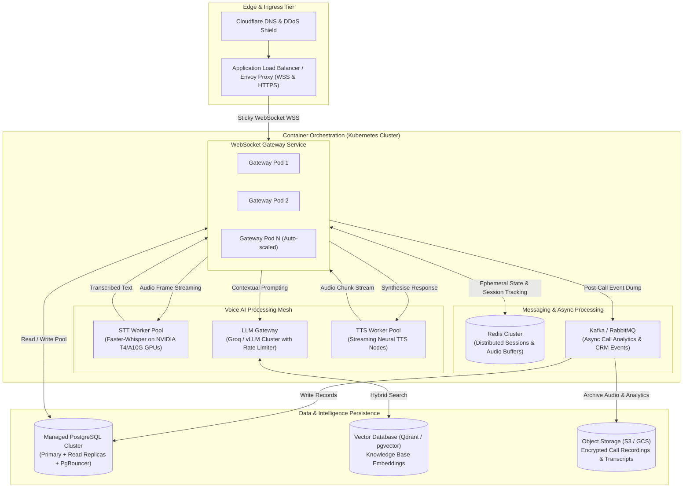

# Scalability, Infrastructure, and Operational Architecture

This document outlines the architectural roadmap for scaling the **Fortivex AI Sales Voice Agent** from its current single-node implementation to an enterprise-grade platform capable of serving **up to 1,00,000 (100,000) active users**.

---

## 1. Distinction: Implemented vs. Proposed Scaling Capabilities

To ensure absolute engineering transparency, the table below clearly delineates what is **currently implemented and verified** in the codebase versus the **proposed architectural scaling measures** designed for high-scale production.

| Architecture Component | Currently Implemented & Verified | Proposed Scaling Measure (100,000 Users) |
| :--- | :--- | :--- |
| **Process Model** | Single-instance FastAPI application on Uvicorn | Containerised microservices deployed on Kubernetes (EKS / GKE) |
| **Session State** | In-memory Python dictionary (`orchestrator._sessions`) | Distributed Redis Cluster with TTL expiration and pub/sub |
| **Database** | Local SQLite database via `aiosqlite` (`sales_agent.db`) | Managed PostgreSQL (Amazon RDS / Aurora) with connection pooling (`PgBouncer`) |
| **Audio Transport** | Single WebSocket endpoint (`/ws/voice/{session_id}`) | Scaled WebSocket gateway with AWS ALB / Envoy sticky sessions or WebRTC |
| **Speech-to-Text (STT)** | Groq / OpenAI Whisper API with deterministic mock fallback | Autoscaling pool of self-hosted Faster-Whisper GPU worker pods (Triton Inference Server) |
| **Text-to-Speech (TTS)** | Microsoft Edge Neural TTS + OpenAI TTS + WAV fallback | Dedicated streaming TTS cluster (Edge-TTS pool or self-hosted XTTS v2 / Piper nodes) |
| **RAG Indexing** | In-memory TF-IDF cosine similarity over JSON files | Distributed Vector Database (Qdrant, Milvus, or pgvector) |
| **Lead & CRM Sync** | Direct asynchronous DB write and webhook dispatch | Asynchronous task queue (Celery / RabbitMQ / Apache Kafka) |

---

## 2. Target Workload Model (100,000 Users)

To scale realistically, we define the engineering parameters of a 100,000-user B2B customer base:
- **Total Registered Accounts / Prospects:** 100,000
- **Daily Active Users (DAU) / Call Volume:** ~10,000 to 20,000 calls per day.
- **Peak Concurrent Calls:** Assuming a 10% peak concurrency during standard business hours (4-hour window), the system must sustain **1,000 to 2,000 simultaneous full-duplex voice streams**.
- **Voice Latency SLA:** End-to-end voice turnaround time (User Speech End → Agent Speech Start) target of **< 1,200 ms**.

---

## 3. High-Scale Infrastructure Architecture

---

## 4. Key Bottlenecks and Mitigation Strategies

### 4.1. WebSocket State & Concurrency
- **Bottleneck:** Maintaining 2,000 persistent TCP connections per single server exhausts OS file descriptors and crashes single event loops.
- **Mitigation:**
  - Offload SSL/TLS termination to cloud load balancers.
  - Scale stateless WebSocket gateway pods horizontally using Kubernetes Horizontal Pod Autoscaler (HPA) targeting CPU and active connection counts.
  - Store active call metadata, turns, and BANT states in Redis rather than Python process memory.

### 4.2. Voice Processing Latency (STT & TTS)
- **Bottleneck:** Sequential HTTP API round-trips to external models introduce 2,000–3,500 ms latency, breaking natural conversational cadence.
- **Mitigation:**
  - **Chunked Audio Streaming:** Ingest audio in 250ms chunks using Voice Activity Detection (VAD) (e.g., Silero VAD) to detect user turn completion instantly.
  - **Self-Hosted GPU Workers:** Deploy containerized Faster-Whisper models on GPU nodes within the same cloud virtual private cloud (VPC) to eliminate public internet routing latency.
  - **Streaming TTS:** Stream synthesised audio chunks back to the client as the first LLM tokens are produced rather than waiting for full-sentence generation.

### 4.3. Database Contention
- **Bottleneck:** SQLite locks entire databases on write operations, causing `sqlite3.OperationalError: database is locked` under concurrent writes.
- **Mitigation:**
  - Transition to PostgreSQL with connection pooling via `PgBouncer`.
  - Partition tables by `tenant_id` or date for high-volume call logging.
  - Perform analytical summarisation and CRM synchronization asynchronously via background worker queues (Celery/Kafka) without blocking real-time voice loops.

---

## 5. Security, Privacy, and Data Governance

1. **Audio Encryption in Transit & Rest:**
   - Enforce TLS 1.3 for all WebSocket (`wss://`) and HTTPS connections.
   - Encrypt call audio files and transcripts stored in S3/GCS using AES-256 with customer-managed encryption keys (KMS).

2. **PII and Sensitive Data Masking:**
   - Apply on-the-fly regex redaction in STT pipelines for payment cards (PCI-DSS), Social Security numbers, and passwords prior to logging or LLM context feeding.

3. **Authentication & Access Control:**
   - Protect REST APIs with JWT Bearer tokens and role-based access control (RBAC).
   - Sign WebSocket connection requests using time-limited cryptographic nonces generated at session initialization.

---

## 6. Operational Cost Factors (Conceptual Overview)

When scaling to 100,000 users, infrastructure costs fall into four primary categories:
1. **Compute Nodes:** Cloud server instances for running API gateways and microservices (CPU-based).
2. **GPU Acceleration:** Dedicated GPU instances (e.g., NVIDIA T4 / A10G) for low-latency Whisper STT inference.
3. **Managed Storage & Database:** Cloud database services (e.g., Amazon Aurora PostgreSQL, ElastiCache Redis, S3 object storage).
4. **Networking & Bandwidth:** Egress bandwidth for continuous two-way audio streaming.

*Note: In accordance with project instructions, exact commercial pricing, third-party dollar estimates, and synthetic benchmark figures are omitted.*
